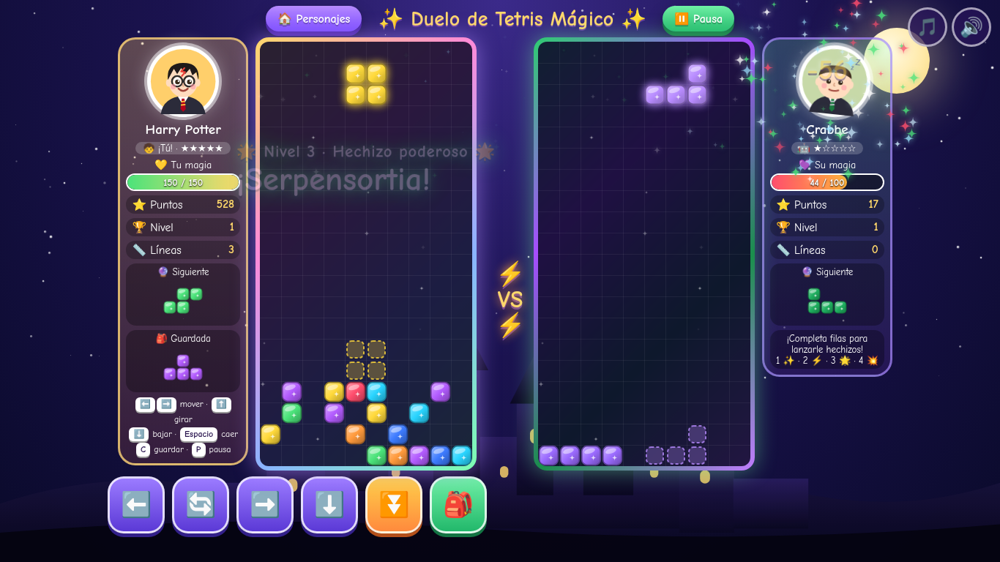

# Tetris Harry Potter

Duelo de dos tableros contra la computadora: elige tu personaje y al oponente por niveles del 1 al 5. Al completar 1, 2, 3 o 4 filas se lanzan hechizos automáticos. Los temas de color evocan las casas de Hogwarts y el juego incluye música de fondo.

## Controles

| Acción | Tecla |
|--------|--------|
| Mover pieza | Flechas ← → |
| Girar | ↑, Z o X |
| Bajar más rápido | ↓ |
| Caída rápida | Espacio |
| Guardar pieza | C |
| Pausa | P |

En pantallas táctiles también hay botones en pantalla para jugar sin teclado.

## Cómo jugar

1. Abre `index.html` en cualquier navegador moderno (funciona sin conexión).
2. O publica el repositorio con [GitHub Pages](https://pages.github.com/) o súbelo a [itch.io](https://itch.io/) como proyecto HTML.

## Capturas

Pantalla de selección de personajes y nivel:

Partida en curso:

## Despliegue

Al fusionar cambios en `main`, GitHub Actions publica el juego en [https://www.simgular.com/tetris-harry-potter/](https://www.simgular.com/tetris-harry-potter/) mediante FTP o FTPS. Solo se suben `index.html` y la carpeta `screenshots/`.

Configura lo siguiente en el repositorio: **Settings → Secrets and variables → Actions**.

### Secrets (obligatorios)

| Nombre | Descripción |
|--------|-------------|
| `FTP_SERVER` | Host del servidor FTP (por ejemplo `ftp.simgular.com`). |
| `FTP_USERNAME` | Usuario FTP del hosting compartido. |
| `FTP_PASSWORD` | Contraseña FTP. |

### Variables (opcionales)

| Nombre | Valor por defecto | Descripción |
|--------|-------------------|-------------|
| `FTP_PROTOCOL` | `ftps` | Protocolo: `ftps` o `ftp` si el proveedor no soporta FTPS explícito. |
| `FTP_SERVER_DIR` | `./public_html/tetris-harry-potter/` | Carpeta remota de destino; debe terminar en `/`. |

También puedes lanzar el despliegue manualmente desde la pestaña **Actions** del repositorio (`workflow_dispatch`).

## Licencia

Consulta el archivo [LICENSE](LICENSE) del repositorio.